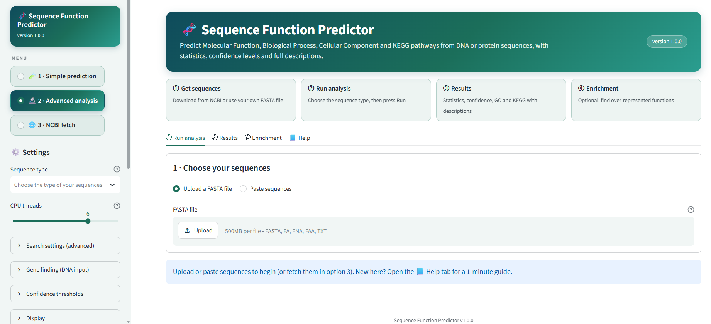
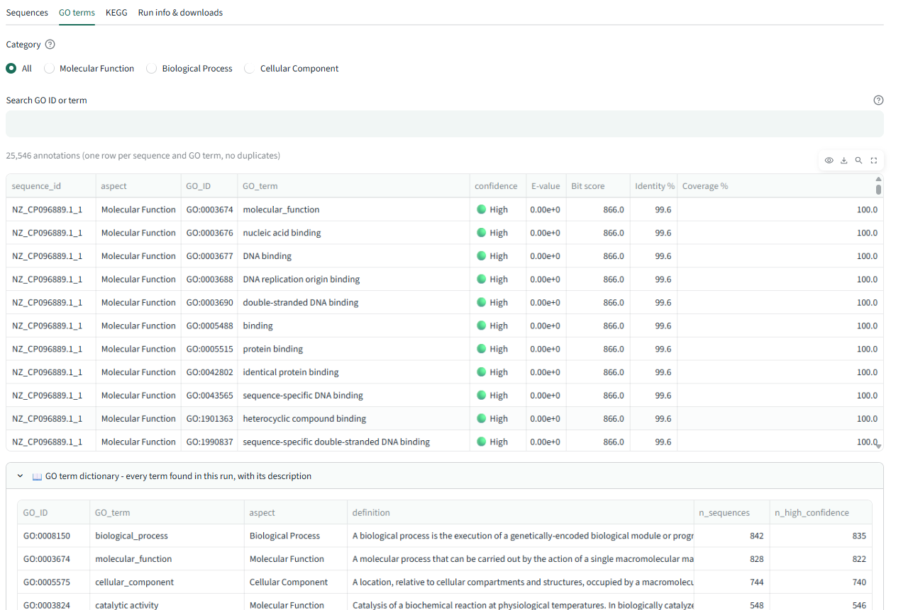
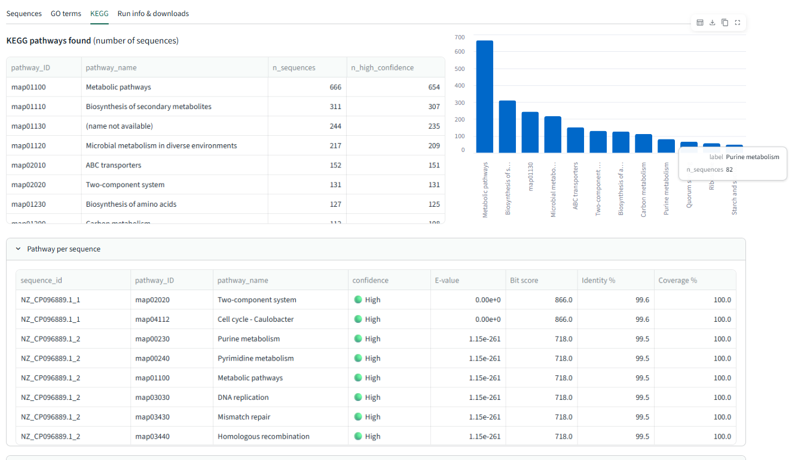

# Sequence Function Predictor

A Streamlit-based web application for evidence-based, ortholog-based functional annotation of biological sequences.

## Features

- Protein FASTA annotation.
- DNA transcript/CDS analysis using longest-ORF translation.
- Prokaryotic genome analysis using Prodigal.
- Functional annotation using eggNOG-mapper.
- Per-protein evidence: E-value, bit score, identity and coverage.
- Heuristic High, Medium and Low confidence categories.
- Gene Ontology (GO) and KEGG annotations.
- GO and KEGG enrichment analysis.
- CSV and Excel result exports.
- Automatic Methods paragraph generation.
- NCBI sequence retrieval.

## Software Requirements

- Python 3.10
- eggNOG-mapper 2.1.13
- DIAMOND 2.2.5
- Prodigal 2.6.3 (required for prokaryotic genome input)
- eggNOG database version 5.0.2

## Python Dependencies

Install the Python packages using:

    pip install -r requirements.txt

## External Database Setup

Download and configure the eggNOG database using the official eggNOG-mapper documentation:

https://github.com/eggnogdb/eggnog-mapper

The database directory must contain:

- eggnog.db
- eggnog_proteins.dmnd
- eggnog.taxa.db
- eggnog.taxa.db.traverse.pkl

By default, the application expects the database in:

    ~/eggnog_data

You can configure another location using the SEQ2FUNC_DB_DIR environment variable.

## Running the Application

Activate the environment containing eggNOG-mapper and its dependencies:

    conda activate bioannotate

Start the application:

    streamlit run app.py

Open the local URL displayed in your terminal.

## Configuration

Application settings can be modified in `scripts/appconfig.py` or configured through environment variables.

The Gene Ontology ontology file is downloaded automatically when needed.

## Scientific Notes

Confidence categories are heuristic classifications based on annotation evidence; they are not probabilities.

Functional annotations are computational predictions and should be interpreted in their biological context and validated where appropriate.

## License

License information will be added following institutional approval.

## Application Screenshots

### Application Homepage

### Functional Annotation Results

### Gene Ontology (GO) Results

### KEGG Results

